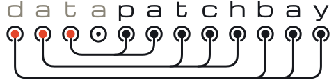

<h1>
  <picture>
    <source media="(prefers-color-scheme: dark)" srcset="assets/logo/datapatchbay-logo-dark.svg">
    
  </picture>
</h1>

Data products as code. Declare owners, ports and freshness in YAML, then scaffold, validate and generate from one lightweight CLI.

Documentation: [datapatchbay.dev](https://datapatchbay.dev)

## Quickstart

You need [uv](https://docs.astral.sh/uv/). Start a repo, scaffold a source-aligned data product, validate it and generate its Airflow DAG:

```sh
uv tool install git+https://github.com/datapatchbay/patchbay   # not on PyPI yet
mkdir jaffle_shop && cd jaffle_shop
echo "schema_version: 1" > datapatchbay.yaml

dpb new --name jaffle_orders --kind source-aligned --owner "Jane Doe" --source jaffle_shop --no-input
dpb validate
dpb generate
```

`dpb new` creates `dataproducts/sa_jaffle_orders/` with its files and a stub Python function per table. `dpb validate` prints `ok: 1 data product(s) valid`, and `dpb generate` writes `generated/sa_jaffle_orders.py`, an Airflow 3 DAG that you deploy to your Airflow (add `generated/` to `.gitignore`: it is build output). Replace the stubs in `src/` with build code that writes the tables to your warehouse, and describe the output port in its `port.yaml` (freshness, readers, PII readers).

[`examples/jaffle_shop`](examples/jaffle_shop) is a finished version with two data products: `sa_jaffle_orders`, built by Python, which ingests from a source and publishes orders with a PII column, and `agg_order_turnaround`, built by dbt, which reads that output port through an input port and the generated `source('sa_jaffle_orders', 'orders')`. Its generated dbt files (properties, sources, tests, `dbt_project.yml`) are committed. The CI `example` job runs both generated DAGs against a real Postgres, including the real `dbt build` and its data tests, and checks that a reader sees NULL in the PII column while a PII reader sees the value.

`dpb validate` checks what the dbt model reads against the dbt manifest, so run `dbt parse` first. The profile of the example reads the connection from the environment (`PGHOST`, `PGUSER`, ...), with defaults that let `dbt parse` run without a server:

```sh
cd examples/jaffle_shop
uv tool install dbt-postgres   # or any environment that has dbt
dbt parse --profiles-dir .     # writes target/manifest.json
dpb validate && dpb list && dpb generate
```

## Editor support

`dpb schema` prints the JSON Schema of the four kinds of file, so an editor can complete and check them as you type. Save the schemas once, and again after upgrading `dpb`:

```sh
mkdir -p .schemas
for kind in root dataproduct port table; do dpb schema $kind > .schemas/$kind.json; done
```

Then point the editor's YAML support (the [YAML extension](https://marketplace.visualstudio.com/items?itemName=redhat.vscode-yaml) in VS Code, or the built-in JSON Schema mappings in JetBrains IDEs) at them. In VS Code, add to `.vscode/settings.json`:

```json
{
  "yaml.schemas": {
    ".schemas/root.json": "datapatchbay.yaml",
    ".schemas/dataproduct.json": "dataproduct.yaml",
    ".schemas/port.json": "port.yaml"
  }
}
```

Table files have no fixed name, so add a modeline at the top of each one (the path is relative to the file):

```yaml
# yaml-language-server: $schema=../../../../.schemas/table.json
```

The schema checks the shape of a file. `dpb validate` also checks the rules across files.

## Development

The project is managed with [uv](https://docs.astral.sh/uv/). `uv sync` creates `.venv` with the package and the dev tools; tests use pytest, ty checks the types and ruff lints and formats:

```sh
uv sync
uv run pytest     # tests
uv run ty check   # type check
uv run ruff check # lint
uv run ruff format --check  # formatting (drop --check to fix)
```

`uv run pytest` runs the unit tests only: no dbt, Airflow, database or Docker. The SQL that `dpb` generates is run against DuckDB in the test process. The integration tests (ADR-0020) need a real Postgres, and one command runs them on a machine that has Docker:

```sh
scripts/integration-tests         # starts Postgres in Docker, runs the tests marked `integration`, stops it
scripts/integration-tests -k audit  # arguments go to pytest
```

It also runs the tests that call the real `dbt parse` on the generated dbt files (dbt comes from the `dbt` dependency group). Run it before pushing a change to the Postgres SQL or to the generated dbt files. CI does not run it. The example runs end to end in Airflow with `tests/airflow/run_example.py`, which its docstring describes: Airflow in its own virtual environment, a Postgres server, and the `bin` folder of an environment with dbt (`uv sync --group dbt` makes `.venv/bin`).

Tests mirror the package: the tests for `src/datapatchbay/x.py` live in `tests/datapatchbay/test_x.py`. See [CODING_STANDARDS.md](CODING_STANDARDS.md) for the rest. Every pull request runs the tests on Python 3.12, 3.13 and 3.14, and runs ty and ruff.

## Building the docs

The docs are Sphinx with the Furo theme:

```sh
uv run --group docs sphinx-build -b html docs docs/_build/html
```

Every push to `main` deploys them to GitHub Pages.
